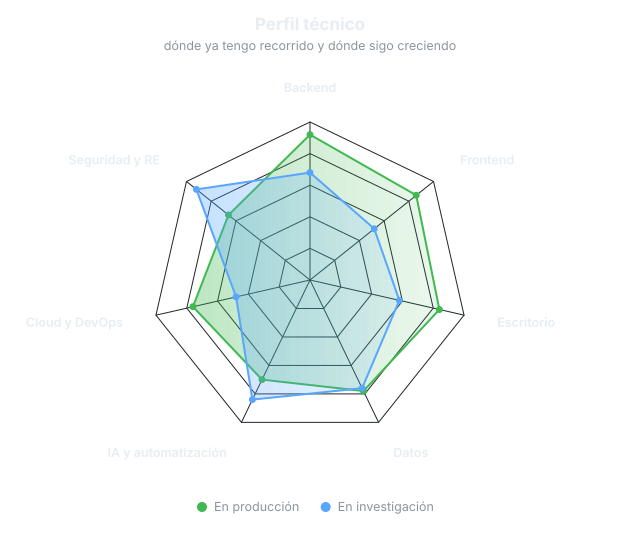
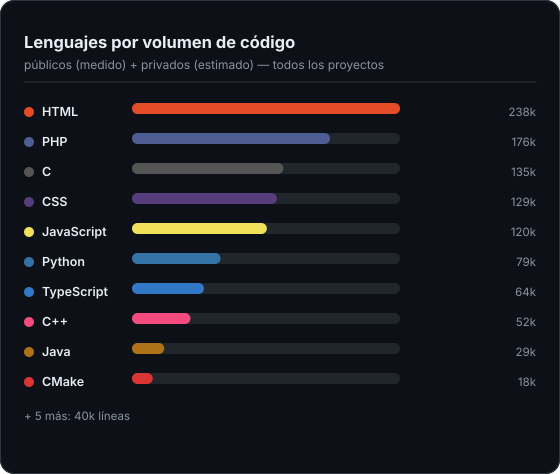

<div align="center">

# Hola, soy Daniel 👋

**Ingeniero de Software · Full Stack · Automatización · IA aplicada**

Construyo software que convierte **procesos complejos y reales** en herramientas
confiables, usables y mantenibles *fuera* del entorno de desarrollo.

[](https://github.com/NoxiousCape)
[](https://mydtravels.com/)
[](mailto:danielpaezzamudio0@hotmail.com)
[](https://twitter.com/NoxiousCape)
[](https://www.instagram.com/noxiouscape/)

</div>

<picture>
  <source media="(prefers-color-scheme: dark)" srcset="assets/banner-dark.v6.svg">
  <source media="(prefers-color-scheme: light)" srcset="assets/banner-light.v6.svg">
  
</picture>

---

<a id="indice"></a>

## 🧭 Índice

[Sobre mí](#sobre-mi) · [Trabajo seleccionado](#trabajo) · [Repos públicos](#repos) ·
[Perfil técnico](#perfil) · [Experiencia](#experiencia) · [Contacto](#contacto)

---

<a id="sobre-mi"></a>

## 🧑‍💻 Sobre mí

Soy **Daniel Steven Páez Zamudio**, ingeniero de Sistemas y Computación de la
**Universidad Pedagógica y Tecnológica de Colombia (UPTC)**, en Sogamoso, Boyacá.

Trabajo sobre todo donde un proceso manual, repetitivo y dependiente de
terceros se puede convertir en **software que aguanta la operación real**:
automatización de portales públicos, sistemas de consulta judicial, herramientas
de escritorio que se instalan con un doble clic e integraciones que sobreviven
a que el servicio externo falle.

```text
✦  Full Stack Web      ·  Aplicaciones de escritorio    ·  IA y LLM
✦  Automatización      ·  Procesamiento de datos        ·  APIs e integraciones
✦  Despliegue en nube  ·  Arquitectura y diseño técnico ·  Datos a escala
```

---

<a id="trabajo"></a>

## 🏗️ Trabajo seleccionado

Una parte de mi portafolio es **privada o confidencial**: el código, los datos y
la infraestructura de varios de estos sistemas no pueden hacerse públicos. Aun
así, lo que construí y por qué está a la vista.

> 👆 **Abre cada proyecto** para ver el stack, los retos técnicos y cómo quedó.
>
> Cada línea lleva una etiqueta de **madurez**: 🟢 en producción · 🔬 trabajo
> documentado · 🛠️ en construcción.

### ⚖️ Plataformas judiciales y de contratación pública

*Trabajo comercial, en producción con usuarios reales.*

<details>
<summary><b>★ 🔎 SECOP Optimizado</b> · escritorio para consultar y seguir procesos de contratación en SECOP<br><i>🟢 En producción · La Manuelina S.A.S. · 2026 · Node.js · React · MariaDB · Playwright</i></summary>

Plataforma **de escritorio** que automatiza la consulta del portal transaccional
del Estado colombiano: 442 códigos UNSPSC, búsquedas por hora y por entidad, y
**lotes automatizados** que se pueden pausar y reanudar.

* Automatización sobre una **sesión autenticada**, con resolución humana del CAPTCHA: el flujo no salta la comprobación ni la resuelve por medios técnicos
* **Caché ≠ base de datos**: cada búsqueda en vivo nutre la base sola; repetir no re-scrapea
* Lotes **reanudables** (3 fallos → pausa, Excel con una hoja por código) y **SSE reanexable**: si se cae la conexión, el servidor retoma la misma búsqueda
* Instalador con doble clic, base propia o reutilización de un MySQL ya presente, y **actualización en un clic** con verificación SHA-256
* **452 pruebas** de Vitest más integración contra MySQL

<!-- CAPTURA: captura del Dashboard o de una búsqueda en curso (app de escritorio).
     Guardar en assets/ y referenciar con 
     El nombre del archivo puede llevar versión para romper la caché, igual que
     los SVG: assets/secop-dashboard.v1.png -->

</details>

<details>
<summary><b>★ 📚 Central de Consultas</b> · plataforma web para consultar procesos judiciales en Colombia<br><i>🟢 En producción · La Manuelina S.A.S. · 2026 · Node.js · Express · MySQL · ExcelJS · SSE</i></summary>

Consulta de procesos judiciales en dos jurisdicciones —**SAMAI** y **Rama
Judicial**— más **consulta masiva** de estados desde Excel.

* Búsqueda por **radicado de 23 dígitos** con identificación automática de la corporación, y por parte procesal sobre un catálogo de **76 corporaciones judiciales**
* **Puente entre jurisdicciones**: los radicados no contenciosos redirigen a Rama Judicial y viceversa, con autobúsqueda en ambas
* Expediente completo, visor PDF con progreso y descarga con el nombre real
* **Consulta masiva** desde Excel: checkpoint reanudable, **soporta lotes de 142 k+ filas**, progreso SSE con ritmo y ETA, reintentos dirigidos y log de fallos por fila
* **Búsqueda ampliada** con barrido geográfico (Departamento → Ciudad → Entidad → Especialidad → Despacho) para superar el límite de 1 000 registros
* **Modo offline**: expedientes y PDFs ya consultados se sirven desde caché

<!-- CAPTURA: pantalla de consulta masiva con el progreso en vivo (SSE) -->

</details>

<details>
<summary><b>★ 🏛️ ASOBANCARIA</b> · gestión de procesos judiciales y legislativos con identidad federada<br><i>🟢 En producción · La Manuelina S.A.S. · 2026 · Next.js · TypeScript · Prisma · MySQL · Entra ID · Railway</i></summary>

Plataforma institucional para el seguimiento de procesos judiciales
(Corte Constitucional y Consejo de Estado) y del **proceso legislativo**
(Senado, Cámara y Gacetas).

* **Autenticación real con Microsoft Entra ID**: app registration, login federado y single sign-out
* Ingesta y **normalización de datos desde Excel** como paso formal del proyecto
* Exportación a Excel y PDF con un criterio visual único
* Despliegue en **Railway** con Dockerfile propio y add-on MySQL
* Entorno local **sin Docker**: SQLite embebido en Prisma y modo `mock` de autenticación

<!-- CAPTURA: tabla de procesos judiciales o detalle de una actuación -->

</details>

<details>
<summary><b>🗂️ Consulta Masiva Procuraduría</b> · escritorio para consultar nombres por lotes de cédulas<br><i>🟢 En producción · TRADENS · 2026 · Python · Playwright · NiceGUI · arquitectura hexagonal</i></summary>

Herramienta que consulta **nombres y apellidos** en la Sede Electrónica de la
Procuraduría General de la Nación a partir de un Excel de cédulas.

* **Investigación documentada**: no existe API REST pública; el portal es *low-code* Appian con reCAPTCHA Enterprise
* **Arquitectura hexagonal** (dominio / puertos / adaptadores): si mañana se contrata una API de pago, se cambia **un solo adaptador** y el negocio no se toca
* Lotes con reintentos con backoff, pausa humana, **checkpoint de reanudación** y deduplicación
* CLI **y** UI web local, distribuida como un único `.exe` portable
* Decisión documentada: portable y no en la nube, porque el reCAPTCHA penaliza las IP de datacenter

</details>

### 🔬 Investigación e ingeniería inversa

*Trabajo propio, documentado y reproducible: se puede leer el método completo.*

<details>
<summary><b>★ 🧬 Abacre Antivirus 1.3</b> · ingeniería inversa forense de un antivirus con 0 % de detección<br><i>🔬 Documentado · código público · Python · C/C++ · VMWare · NTSD · OllyDbg</i></summary>

Análisis estático y forense de un antivirus de 2006 que obtuvo **0 % de
detección** en dos pruebas de `virus.gr` (113 334 y 147 184 muestras).

* **Protocolo académico estricto**: los binarios nunca se ejecutan en el host, solo en una VM aislada **sin red** (Windows XP SP3)
* El *packer* detecta a OllyDbg (`Error 251`); `NTSD -pv` permite obtener un **dump completo de 29 MB** sin activar la detección
* Hallazgo central: cifrador **Blowfish** y una base de solo **67 firmas (2003-2005)** — la explicación plausible del 0 %
* 24 capturas de debugging, scripts Python reproducibles y hashes SHA-256 de cada artefacto
* **Honestidad intelectual**: el README separa hechos de hipótesis y enumera lo que **no** se pudo verificar

🔗 **[NoxiousCape/Abacre_Investigation](https://github.com/NoxiousCape/Abacre_Investigation)**

</details>

<details>
<summary><b>🔎 Investigación de portales sin API pública</b> · cómo se resuelve un sistema que no ofrece interfaz<br><i>🔬 Documentado · SECOP · SAMAI · Rama Judicial · Procuraduría · Curaduría</i></summary>

Parte del trabajo no es una aplicación, es **descubrir cómo funciona un sistema
que no ofrece interfaz para lo que necesito**:

| Portal | El obstáculo | La salida |
|---|---|---|
| **SECOP** | Transaccional con captcha, sin API documentada | Sesión autenticada + automatización con las reglas del portal respetadas |
| **SAMAI** | Sólo expone expediente y documentos vía sesión web | Playwright con reintentos, backoff y clasificación de errores |
| **Rama Judicial** | API JSON real, con tope de 1 000 registros | Pacer global y barrido geográfico para rodear el tope |
| **Procuraduría** | Appian *low-code* con reCAPTCHA Enterprise | Dominio propio con puerto `ProveedorConsulta` intercambiable |
| **Curaduría Urbana** | Resoluciones en PDF escaneado | Pipeline OCR con detección de la página resumen y saneado de alucinaciones |

El resultado suele acabar en un **dataset de referencia** —como los 17 457
elementos de la tabla piramidal— o en una capa de abstracción que permite
cambiar de proveedor sin reescribir el negocio.

</details>

<details>
<summary><b>🏗️ CodRamExc</b> · dataset y herramienta de los códigos de radicación de la Rama Judicial<br><i>🔬 Documentado · Python · requests · openpyxl · PyInstaller</i></summary>

Extrae la **estructura jerárquica real** de los códigos que usa la Rama Judicial
para construir el número de radicación, y la exporta como tabla piramidal
clasificada por ciudad.

* Cobertura **nacional**: 33 departamentos, **17 457 elementos**, 11 551 rutas constructoras, reporte de inconsistencias sin observaciones
* Excel de 5 hojas: estructura jerárquica, datos normalizados, **constructor de códigos**, relaciones y reporte de calidad
* Extracción **reanudable** (caché + checkpoint) frente a 403 intermitentes y respuestas vacías: el reintento y el backoff son explícitos, nunca silenciosos
* La investigación de la fuente y la validación ejecutada están documentadas por separado (`INVESTIGACION.md`, `VALIDACION.md`)

</details>

### 🏛️ Repositorios públicos

*Código abierto: se puede leer, ejecutar y auditar.*

<a id="repos"></a>

| Repositorio | Qué es | Stack |
|---|---|---|
| **[Abacre_Investigation](https://github.com/NoxiousCape/Abacre_Investigation)** | Ingeniería inversa forense de un antivirus histórico | `Python` `C/C++` |
| **[La_Manuelina_Web](https://github.com/NoxiousCape/La_Manuelina_Web)** | Portal SECOP & CC2026: normalización de datos, MySQL, roles JWT y PWA offline | `Node.js` `Express` `MySQL` `PWA` |
| **[SIGBMS](https://github.com/NoxiousCape/SIGBMS)** | Sistema integral de gestión para la Biblioteca Municipal de Sogamoso | `Java 21` `Spring Boot 3.1` `MySQL 8` |
| **[UnBlockEx](https://github.com/NoxiousCape/UnBlockEx)** | Recuperación de Excel cifrado (AES-256) por tres estrategias | `Python` `Tkinter` |
| **[Triki](https://github.com/NoxiousCape/Triki)** | Tres en línea: web *glassmorphism* + consola en Ruby, IA con Minimax | `JavaScript` `Ruby` |
| **[Cadenas_en_C](https://github.com/NoxiousCape/Cadenas_en_C)** | Manipulación de cadenas con menú interactivo | `C` |
| **[Procesos_SECOP-Releases](https://github.com/NoxiousCape/Procesos_SECOP-Releases)** | Canal público de releases del instalador de SECOP (el código es privado) | — |

> **SIGBMS** se desarrolló para la materia *Ingeniería de Software II* de la
> **UPTC**, junto a dos compañeros y bajo la dirección del Ing. Edmundo Junco.

### 🌍 Sitios y productos para clientes

*Trabajo comercial entregado y en funcionamiento.*

| Proyecto | En vivo | Qué hay detrás |
|---|---|---|
| **M&D Travels** | [mydtravels.com](https://mydtravels.com/) | Sitio + asistente de viajes con IA, blog desde RSS, PWA, reCAPTCHA y Resend |
| **M&D Cotizaciones** *(escritorio)* | — | App **Electron** con navegador embebido, captura de ofertas en un clic, export a Excel y PDF con LaTeX, IA opcional y auto-actualización |
| **DeleitArte** *(pastelería)* | [pasteleriadeleitarte.com](https://pasteleriadeleitarte.com/) | Catálogo, **armador de pasteles 3D**, pedido libre con foto, reserva de espacio multi-paso y PWA |
| **JR Mantenimiento Eléctrico** | [jrmantenimientoelectrico.com](https://jrmantenimientoelectrico.com/) | Sitio corporativo con GSAP y Swiper, PWA, legal (Habeas Data) y SEO técnico |
| **Beniet Perfumería** *(Dupé)* | [duperfumes.vercel.app](https://duperfumes.vercel.app/) | E-commerce editorial con React + Vite, **kiosco táctil con quiz** y PWA |
| **La Manuelina** *(web)* | — | Portal institucional con módulos de SECOP y Corte Constitucional, roles y PWA offline |

---

<a id="en-desarrollo"></a>

## 🚧 En desarrollo

*Proyecto propio, en construcción: lo que viene después.*

<details>
<summary><b>🏙️ SogNow</b> · plataforma cívica para rastrear los proyectos urbanos de Sogamoso<br><i>🛠️ En construcción · proyecto propio · Python · FastAPI · PostgreSQL + PostGIS · Next.js · Leaflet</i></summary>

Centraliza, rastrea y **visualiza los proyectos urbanos** (privados y públicos)
de Sogamoso, hoy dispersos entre curaduría, secretaría, medios locales y redes
sociales.

* **Fase 1 — MVP (en ejecución):** esquema PostGIS, motor de extracción **OCR** y filtrado por impacto urbanístico (niveles, área, uso)
* **Fase 2 — Automatización:** scraping de licencias PDF de la Curaduría, detección de la página resumen del proyecto y normalización de OCR y direcciones
* **Fase 3:** alertas por zona, enriquecimiento con IA y dashboard de estadísticas urbanas

</details>

---

<a id="perfil"></a>

## 🧠 Perfil técnico

<picture>
  <source media="(prefers-color-scheme: dark)" srcset="assets/radar-dark.v6.svg">
  <source media="(prefers-color-scheme: light)" srcset="assets/radar-light.v6.svg">
  
</picture>

<sub>El radar **no** es una puntuación de prestigio: contrasta lo que ya está
**aplicado en producción** contra lo que está **en investigación**. La evidencia
de lo primero son los proyectos de arriba.</sub>

<div align="center">


</div>

> 🤖 **IA aplicada, no experimentos de laboratorio.** Un recomendador que
> degrada a un *fallback* local cuando el modelo no responde; un redactor que
> **sólo redacta y jamás busca** (la búsqueda la hace una persona, con
> criterio); y un pipeline OCR con detección de la página resumen y saneado de
> alucinaciones sobre documentos escaneados. En los tres casos, la IA es una
> pieza dentro de un sistema que tiene que funcionar sin ella.

| Todo el portafolio (público + privado) | Solo repos públicos (medido por la API) |
|---|---|
| <picture><source media="(prefers-color-scheme: dark)" srcset="assets/metrics.languages-dark.v6.svg"><source media="(prefers-color-scheme: light)" srcset="assets/metrics.languages-light.v6.svg"></picture> |  |

<sub>La columna izquierda suma los repos públicos (medidos con la API de GitHub) y
los proyectos privados (estimados a partir de su estructura). La derecha es la
métrica estándar de GitHub, sin estimaciones.</sub>

<details>
<summary><b>Ver el stack por capas</b></summary>

| Capa | Tecnologías |
|---|---|
| **Lenguajes** | `TypeScript` · `JavaScript` · `Python` · `Java` · `C#` · `C` / `C++` |
| **Frontend** | `React` · `Next.js` · `HTML5` · `CSS3` · `Tailwind CSS` · `Three.js` · `GSAP` |
| **Backend** | `Node.js` · `Express` · `Spring Boot` · `REST APIs` · `SSE` |
| **Escritorio** | `Electron` · `Python (Tkinter / NiceGUI)` · `PyInstaller` · `Inno Setup` |
| **Datos** | `MySQL` · `PostgreSQL + PostGIS` · `SQLite` · `Excel` · `LaTeX` |
| **Automatización** | `Playwright` · `OCR (Tesseract)` · `n8n` · `OpenRouter` · `Gemini API` |
| **Despliegue** | `Git` · `GitHub Actions` · `Docker` · `Railway` · `Vercel` · `Azure` |
| **Otros** | `Unity` · `QGIS` · `ROS` |

</details>

---

<a id="experiencia"></a>

## 💼 Experiencia profesional

**🏢 Full Stack Developer — La Manuelina S.A.S.** *(Septiembre 2026 — actualidad)*
Desarrollo de soluciones para requisitos operativos e institucionales: plataformas
web full stack · arquitectura y diseño técnico · integraciones de autenticación
e identidad · diseño de bases de datos · APIs · ingesta y procesamiento de
datos · automatización y herramientas internas · infraestructura de nube ·
integración con sistemas externos.

**✈️ Software Engineer & Co-Founder — M&D Travels Colombia**
Construcción de la infraestructura digital de la empresa: plataformas web,
software interno, automatización y herramientas asistidas por IA.

**🎮 Unity Programming Instructor — Kodland**
Enseñanza de programación y desarrollo de juegos con **C# y Unity**.

---

## 🔒 Trabajo comercial y confidencial

No todo mi trabajo puede hacerse público. Varios de los sistemas que desarrollo
están destinados a **empresas, operaciones internas e entornos institucionales**,
donde el código, los datos y la infraestructura no pueden exponerse.

Incluso con el repositorio en privado, sí puedo explicar la ingeniería detrás
del proyecto: arquitectura, integraciones de API, diseño de base de datos,
autenticación e identidad, procesamiento de datos, estrategias de
automatización, caché y resiliencia, infraestructura de despliegue, flujos de
trabajo, consideraciones de rendimiento y los desafíos técnicos con sus
soluciones.

> **Construir software que tiene que funcionar más allá del entorno de desarrollo
> es una parte importante de mi experiencia.**

---

<a id="contacto"></a>

## 📫 Contacto

[](mailto:danielpaezzamudio0@hotmail.com)
[](https://github.com/NoxiousCape)
[](https://twitter.com/NoxiousCape)
[](https://www.instagram.com/noxiouscape/)
[](https://www.facebook.com/danielsteven.paezzamudio)

Si tienes un proceso manual, repetitivo o dependiente de un tercero que te
gasta horas al mes, probablemente se pueda automatizar. **Escríbeme.**

---

<div align="center">

<sub>Hecho con ☕ en Sogamoso, Boyacá — Colombia 🇨🇴</sub>

</div>
